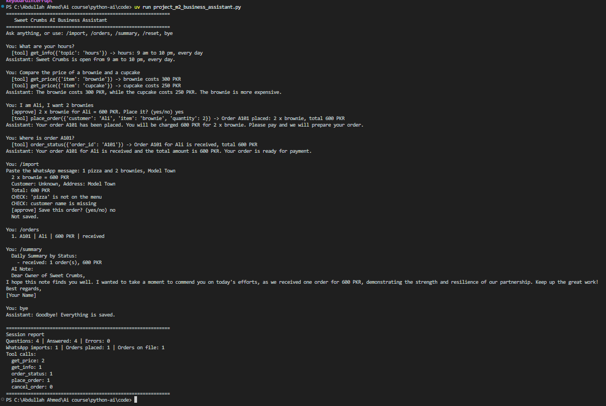
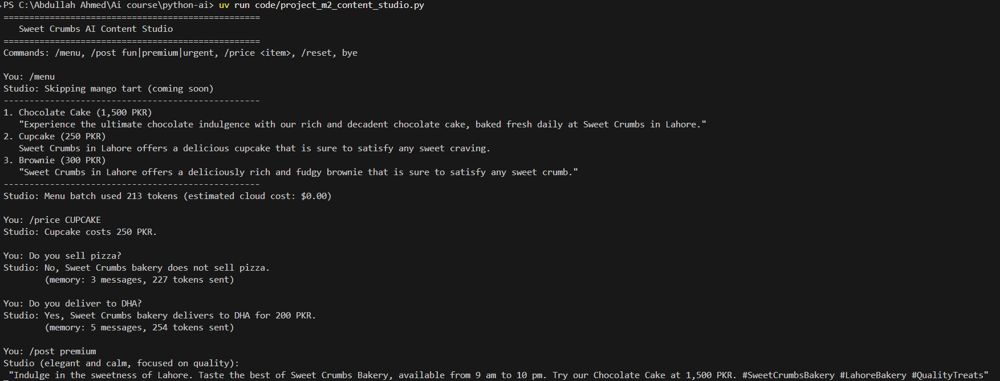

# 🤖 AI-Driven Python Learning Journey

<div align="center">

**From Python fundamentals → Applied AI & Agentic Workflows**

[](https://www.python.org/)
[](https://www.langchain.com/)
[](https://ollama.ai/)
[](LICENSE)

A structured, hands-on progression from scripting basics to building **production-ready AI systems**, **hybrid rule/LLM pipelines**, and **autonomous agentic workflows** — all running on local models with zero API costs.

[Getting Started](#-getting-started) · [Projects](#-featured-projects) · [Lessons](#-curriculum-map) · [Docs](#-documentation) · [Principles](#-engineering-principles)

</div>

---

## ✨ Highlights

- 🏗️ **2 capstone projects** — a conversational content studio and an agentic business assistant with tool-calling, human-in-the-loop approval, and WhatsApp order extraction
- 🤖 **First agent** — LangChain tool-calling agent with human approval gates, FAQ lookup, pricing tools, and order placement
- 🧠 **Structured extraction** — Ollama JSON-mode parsing of messy bilingual WhatsApp messages with hallucination detection
- 🔒 **100% local inference** — every project runs on Ollama (Gemma 3 4B, Qwen 2.5 3B, Llama 3.2) with zero cloud dependency
- 📊 **Self-documenting** — each project ships with architectural design docs, test matrices, and real terminal run screenshots

---

## 📂 Repository Structure

```
python-ai/
├── code/                          # All source code
│   ├── module-1/                  # Module 1 lessons & capstones
│   │   ├── project_m1_front_desk.py
│   │   ├── project_m1_prompt_kit.py
│   │   └── lesson_01..08_*.py
│   ├── project_m2_content_studio.py    # Module 2 Checkpoint Capstone
│   ├── project_m2_business_assistant.py # Module 2 Final Capstone ⭐
│   ├── lesson_2_1..2_8_*.py            # Module 2 lessons
│   ├── business.json              # Owner-editable bakery facts
│   ├── faq.json                   # FAQ knowledge base
│   └── orders.json                # Persisted order data
├── docs/                          # Design docs, test results, screenshots
│   ├── module-1/                  # Module 1 documentation
│   └── *.md / *.png               # Module 2 documentation
├── notebooks/                     # Jupyter notebooks for experimentation
├── pyproject.toml                 # Project config (uv)
└── uv.lock                       # Locked dependencies
```

---

## 🥐 Featured Projects

### 1. AI Business Assistant — Module 2 Final Capstone ⭐

> *Source: [`project_m2_business_assistant.py`](code/project_m2_business_assistant.py) · Design: [`project-m2-final-design.md`](docs/project-m2-final-design.md) · Results: [`project-m2-final-results.md`](docs/project-m2-final-results.md)*

A full **agentic AI assistant** for Sweet Crumbs Bakery that demonstrates real-world agentic patterns:

| Capability | How It Works |
| :--- | :--- |
| **🔧 Tool-calling agent** | LangChain tools for price lookup, order status, FAQ answers, and order placement — the LLM decides which tool to call |
| **✋ Human-in-the-loop** | Owner must approve or reject every order placement in the terminal before it's saved |
| **📱 WhatsApp order import** | Extracts structured orders from messy English/Roman Urdu WhatsApp messages using Ollama JSON mode |
| **🛡️ Hallucination guards** | Python validates every extracted field — catches invented names, plural normalization, off-menu items |
| **💾 Persistent state** | Chat transcript, orders, and errors survive across sessions via JSON files |
| **📊 Session reports** | End-of-session analytics with message counts, orders processed, and error summaries |
| **⚡ Graceful error handling** | Connection failures and model errors logged to `errors.log` without crashing |

```powershell
uv run python code/project_m2_business_assistant.py
```

<details>
<summary>📸 Terminal Screenshot</summary>



</details>

---

### 2. AI Content Studio — Module 2 Checkpoint Capstone

> *Source: [`project_m2_content_studio.py`](code/project_m2_content_studio.py) · Design: [`project-m2-cp1-design.md`](docs/project-m2-cp1-design.md) · Results: [`project-m2-cp1-results.md`](docs/project-m2-cp1-results.md)*

A multi-purpose marketing and operations tool for bakery staff:

- **`/menu`** — Batch-generates appetizing descriptions for all in-stock items, skips zero-priced items, reports token usage and estimated cloud costs
- **`/post <tone>`** — Streams social media posts word-by-word in `fun`, `premium`, or `urgent` brand voice
- **Roman Urdu translation** — Auto-translates marketing posts into natural Pakistani Roman Urdu while preserving PKR prices and locations
- **`/price <item>`** — Zero-token deterministic dictionary lookup (no LLM call, instant, 100% accurate)
- **Grounded chat** — Answers customer questions strictly from injected business facts with sliding-window memory (`max_messages=6`)

```powershell
uv run python code/project_m2_content_studio.py
```

<details>
<summary>📸 Terminal Screenshot</summary>



</details>

---

### 3. AI Front Desk Assistant — Module 1 Capstone

> *Source: [`project_m1_front_desk.py`](code/module-1/project_m1_front_desk.py) · Design: [`project-m1-part2-design.md`](docs/module-1/project-m1-part2-design.md) · Results: [`project-m1-part2-results.md`](docs/module-1/project-m1-part2-results.md)*

A customer-facing automation combining deterministic speed with intelligent fallback:

- **Complaint-first intent hierarchy** — Catches urgent issues and triggers immediate manager escalation
- **Interactive `/quote` calculator** — Bulk orders, tiered discounts, and delivery fee rules with input validation
- **Privacy-preserving routing** — Detects PII (phone/CNIC) and routes to local Ollama models for 100% data confidentiality

```powershell
uv run python code/module-1/project_m1_front_desk.py
```

---

## 📚 Curriculum Map

### Module 2: LLM Integration, Agents & Production AI

| # | Lesson | Key Concepts | Source |
| :---: | :--- | :--- | :--- |
| **2.8** | First Tool-Calling Agent | LangChain tools, agentic loops, human approval gates | [`lesson_2_8_first_agent.py`](code/lesson_2_8_first_agent.py) |
| **2.7** | Structured Extractor | Ollama JSON mode, schema validation, hallucination hunting | [`lesson_2_7_extractor.py`](code/lesson_2_7_extractor.py) |
| **2.6** | Saved Bot | FAQ from JSON, persistent history, error logging | [`lesson_2_6_saved_bot.py`](code/lesson_2_6_saved_bot.py) |
| **2.5** | AI Skills Toolkit | Reusable AI functions, summarization, translation, review replies | [`lesson_2_5_ai_skills.py`](code/lesson_2_5_ai_skills.py) |
| **2.4** | Batch Writer | Automated batch generation, token accumulation, cost estimation | [`lesson_2_4_batch_writer.py`](code/lesson_2_4_batch_writer.py) |
| **2.3** | Persona Bot | Dynamic persona switching, factual grounding | [`lesson_2_3_persona_bot.py`](code/lesson_2_3_persona_bot.py) |
| **2.2** | Chat Memory | Multi-turn conversations, sliding-window context management | [`lesson_2_2_chat_memory.py`](code/lesson_2_2_chat_memory.py) |
| **2.1** | First AI Call | LLM invocation, token counting, latency profiling | [`lesson_2_1_first_ai_call.py`](code/lesson_2_1_first_ai_call.py) |

### Module 1: Foundations & Interactive Business Automations

| # | Lesson | Key Concepts | Source |
| :---: | :--- | :--- | :--- |
| **08** | Mini Chatbot | Intent hierarchy, complaint routing, human handover | [`lesson_08_mini_chatbot.py`](code/module-1/lesson_08_mini_chatbot.py) |
| **07** | Smart Router | Local vs. cloud model routing, privacy constraints | [`lesson_07_conditions.py`](code/module-1/lesson_07_conditions.py) |
| **06** | String Hygiene | Prompt sanitization, input cleaning | [`lesson_06_strings_prompts.py`](code/module-1/lesson_06_strings_prompts.py) |
| **05** | Variables | State & context management with typed variables | [`lesson_05_variables.py`](code/module-1/lesson_05_variables.py) |
| **04** | Print & Input | Dynamic prompt generation, interactive I/O | [`lesson_04_print_input.py`](code/module-1/lesson_04_print_input.py) |
| **02** | Toolkit Setup | Python, uv, Ollama, IDE diagnostics | [`lesson_02_toolkit.py`](code/module-1/lesson_02_toolkit.py) |
| **01** | Intro | Learning roadmap & personal vision | [`lesson_01_intro.py`](code/module-1/lesson_01_intro.py) |

---

## 🧠 Architecture Overview

```
                    ┌──────────────────────────────────────────┐
                    │      Sweet Crumbs AI Ecosystem           │
                    └──────────────────┬───────────────────────┘
                                       │
       ┌───────────────────────────────┼───────────────────────────────┐
       │                               │                               │
       ▼                               ▼                               ▼
┌──────────────┐            ┌───────────────────┐           ┌──────────────────┐
│  Module 1    │            │  Module 2 (CP1)   │           │ Module 2 (Final) │
│  Front Desk  │            │  Content Studio   │           │ Business Agent ⭐│
├──────────────┤            ├───────────────────┤           ├──────────────────┤
│ • Complaint  │            │ • Batch menu copy │           │ • Tool-calling   │
│   routing    │            │ • Social posts    │           │   agent loop     │
│ • /quote     │            │ • Roman Urdu i18n │           │ • Human approval │
│   calculator │            │ • 0-token lookup  │           │ • WhatsApp import│
│ • PII router │            │ • Sliding memory  │           │ • JSON extraction│
│ • Rule + AI  │            │ • Session metrics │           │ • Error logging  │
│   blend      │            │                   │           │ • Persistent I/O │
└──────────────┘            └───────────────────┘           └──────────────────┘
```

### Model & Temperature Matrix

| Component | Model | Temp | Purpose |
| :--- | :--- | :---: | :--- |
| Customer chat | `gemma3:4b` | 0.2 | Strictly factual, grounded responses |
| Menu generator | `gemma3:4b` | 0.8 | Creative, appetizing descriptions |
| Social posts | `gemma3:4b` | 0.8 | Stylistic brand-voice flair |
| Urdu translation | `gemma3:4b` | 0.2 | Accurate localization, preserving prices |
| Business agent | `qwen2.5:3b` | — | Tool-calling agent with agentic loop |
| Privacy router | `llama3.2` | 0.2 | Zero-cost local PII-safe inference |
| Price lookup | Python `dict` | N/A | Instant, 0 tokens, 100% accurate |

---

## 📄 Documentation

### Module 2

| Document | Description |
| :--- | :--- |
| [`project-m2-final-design.md`](docs/project-m2-final-design.md) | Architecture, tool definitions, test tables for the Business Assistant |
| [`project-m2-final-results.md`](docs/project-m2-final-results.md) | Agent error analysis, WhatsApp hallucination catches, quality tests |
| [`project-m2-cp1-design.md`](docs/project-m2-cp1-design.md) | Content Studio design, temperature allocation, facts mapping |
| [`project-m2-cp1-results.md`](docs/project-m2-cp1-results.md) | Factual QA validation, tone analysis, Roman Urdu evaluation |
| [`hallucination-hunt.md`](docs/hallucination-hunt.md) | Detailed hallucination analysis from WhatsApp order extraction |
| [`my-answers-module-2.md`](docs/my-answers-module-2.md) | Conceptual checkpoint answers for Lessons 2.1–2.4 |

### Module 1

| Document | Description |
| :--- | :--- |
| [`project-m1-part2-design.md`](docs/module-1/project-m1-part2-design.md) | Front Desk architecture, intent hierarchy, pricing formulas |
| [`project-m1-part2-results.md`](docs/module-1/project-m1-part2-results.md) | Local LLM test runs, grounded vs. hallucinated responses |
| [`project-m1-results.md`](docs/module-1/project-m1-results.md) | Business Prompt Kit output evaluation |
| [`my-answers-module-1.md`](docs/module-1/my-answers-module-1.md) | Conceptual checkpoint answers for Module 1 |
| [`prompt-test.md`](docs/module-1/prompt-test.md) | Prompt engineering experiments |
| [`ollama-first-chat.md`](docs/module-1/ollama-first-chat.md) | Local LLM setup verification |

---

## 🚀 Getting Started

### Prerequisites

- [Python 3.14+](https://www.python.org/)
- [`uv`](https://astral.sh/uv) — fast Python package manager
- [Ollama](https://ollama.ai/) — local LLM runtime

### Installation

```powershell
# Clone the repository
git clone https://github.com/AbdullahAhmed922/python-ai.git
cd python-ai

# Create virtual environment & install dependencies
uv sync

# Pull the local models
ollama pull gemma3:4b      # Content Studio & extraction
ollama pull qwen2.5:3b     # Business Assistant agent
ollama pull llama3.2        # Privacy routing & support bot
```

### Run the Projects

```powershell
# ⭐ Module 2 Final: AI Business Assistant (agentic, tool-calling)
uv run python code/project_m2_business_assistant.py

# 🥐 Module 2 Checkpoint: AI Content Studio
uv run python code/project_m2_content_studio.py

# 🏪 Module 1: AI Front Desk Assistant
uv run python code/module-1/project_m1_front_desk.py

# 📝 Module 1: Business Prompt Kit
uv run python code/module-1/project_m1_prompt_kit.py
```

<details>
<summary><strong>Run individual lessons</strong></summary>

```powershell
# Module 2 Lessons
uv run python code/lesson_2_8_first_agent.py      # Tool-calling agent
uv run python code/lesson_2_7_extractor.py         # Structured extraction
uv run python code/lesson_2_6_saved_bot.py         # Persistent bot
uv run python code/lesson_2_5_ai_skills.py         # AI skills toolkit
uv run python code/lesson_2_4_batch_writer.py      # Batch writer
uv run python code/lesson_2_3_persona_bot.py       # Persona bot
uv run python code/lesson_2_2_chat_memory.py       # Chat memory
uv run python code/lesson_2_1_first_ai_call.py     # First AI call

# Module 1 Lessons
uv run python code/module-1/lesson_08_mini_chatbot.py
uv run python code/module-1/lesson_07_conditions.py
uv run python code/module-1/lesson_06_strings_prompts.py
uv run python code/module-1/lesson_05_variables.py
uv run python code/module-1/lesson_04_print_input.py
uv run python code/module-1/lesson_02_toolkit.py
uv run python code/module-1/lesson_01_intro.py
```

</details>

---

## 📌 Engineering Principles

| # | Principle | Why It Matters |
| :---: | :--- | :--- |
| 1 | **Deterministic-first, AI-second** | Never spend tokens on tasks solved by a dictionary lookup — zero latency, \$0 cost, 100% accuracy |
| 2 | **Temperature separation** | Factual tasks at 0.2 (grounded); creative copy at 0.8 (varied). Never mix them |
| 3 | **Context window stewardship** | Sliding-window memory (`[system] + history[-N:]`) prevents unbounded token growth |
| 4 | **Human-in-the-loop for high-stakes actions** | Orders require explicit owner approval — the agent proposes, the human decides |
| 5 | **Python validates, LLM generates** | Every structured LLM output is checked by Python (prices, names, menu items) before acting on it |
| 6 | **Privacy via edge inference** | PII (phones, CNICs) routes to local Ollama models — air-gapped data privacy, zero API cost |
| 7 | **Graceful degradation** | Connection errors and corrupt files are logged and recovered from, never crash the user session |
| 8 | **Hallucination prevention** | Strict system-prompt boundaries + fact injection + Python guardrails prevent invented information |

---

## 🛠️ Tech Stack

| Category | Tools |
| :--- | :--- |
| **Language** | Python 3.14 |
| **Package Manager** | [`uv`](https://astral.sh/uv) |
| **AI Framework** | [LangChain](https://www.langchain.com/) (langchain, langchain-ollama) |
| **Local LLM Runtime** | [Ollama](https://ollama.ai/) — gemma3:4b, qwen2.5:3b, llama3.2 |
| **Notebooks** | Jupyter / ipykernel |
| **Dev Environment** | Antigravity IDE, Claude Code |
| **OS** | Windows 11 / PowerShell |

---

## 👤 Author

**Abdullah Ahmed**
*Aspiring Applied AI & Agentic Workflow Engineer*

📍 Lahore, Pakistan · 📧 [abd1962964@gmail.com](mailto:abd1962964@gmail.com) · 🔗 [GitHub](https://github.com/AbdullahAhmed922)
